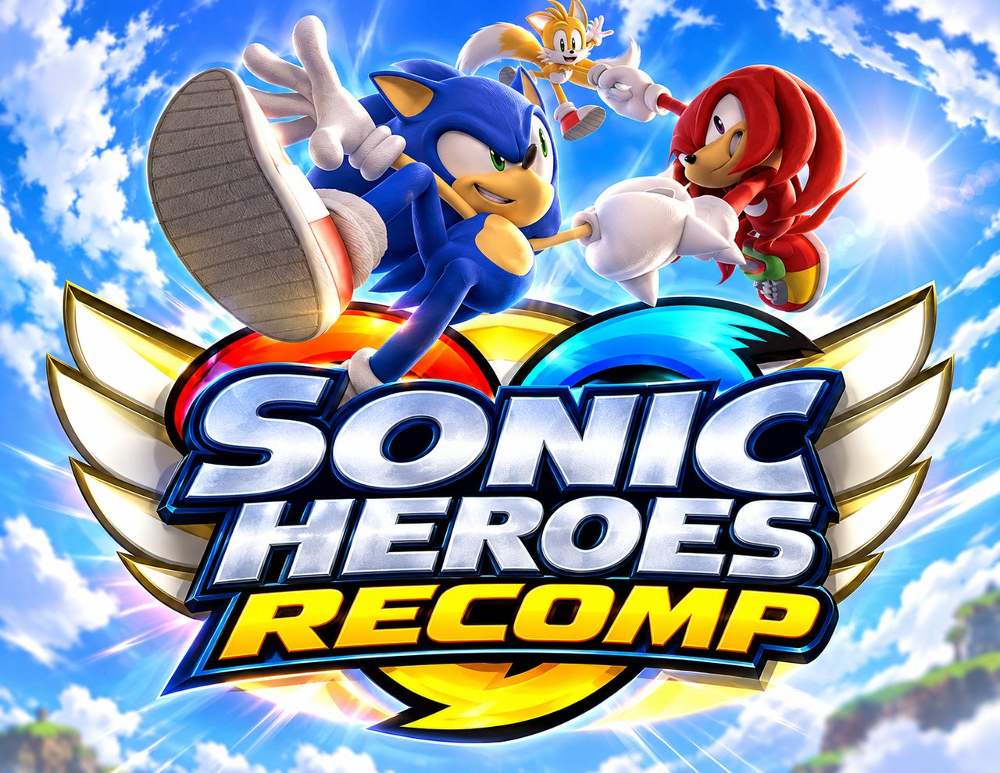

<p align="center">
  
</p>

# Sonic Heroes native port

Play **Sonic Heroes** (GameCube, USA) natively, with no emulator, on a modded **Nintendo Switch**, and later on
**Windows**, **Android**, **Linux / Steam Deck** and **iPhone / iPad**. The game is rebuilt on your own PC from
**your own disc image**; this project contains no game files.

> [!IMPORTANT]
> **Work in progress. There is no release yet and nothing to download.** The first release, **v0.5.0**, comes
> once the game is playable on the **Switch and Android**. Day-to-day status: [STATE.md](STATE.md).

## Progress toward v1.0

```
[█████░░░░░░░░░░░░░░░]  25%
```

An estimate of the work left to a complete v1.0, updated as it moves:

| | Part | Status |
|---|---|---|
| ✅ | Recompiler: `main.dol` + all 17 usable `.rel` modules translated, each at its own address | done |
| ✅ | Boot: logos, title screen, menus, story movie, first stage (Seaside Hill) on PC | done |
| ✅ | Switch: first stage at 60 fps on the console (handheld), shaders built ahead of time | done |
| 🔲 | Every stage, team, boss and special stage plays through; saves; sound and movies checked | |
| 🔲 | 2-player modes (split screen) at full speed on the Switch | |
| 🔲 | Android build | |
| 🔲 | Setup tool (builds the game from your disc), installers → **v0.5.0** | |
| 🔲 | Settings menu, widescreen, quality options, Windows / Linux / Steam Deck / iOS builds | |
| 🔲 | Long play-tests on every platform → **v1.0** | |

**You will need:** your own **Sonic Heroes (USA)** disc image (`G9SE8P`, revision 0, a full 1.4 GB `.iso`).

## How it works

The game's PowerPC code (`main.dol` and its 18 `.rel` modules) is translated to C ahead of time on your PC
(**static recompilation**), and the GameCube hardware (graphics, disc, audio, memory card, controllers) is
reimplemented natively: deko3d on the Switch, OpenGL / Vulkan elsewhere. This project is a fork of the
[Sonic Riders native port](https://github.com/teclilla18/sonic-riders-recomp), which follows
[SwitchWakerHD](https://github.com/centollOS/SwitchWakerHD) and
[ZeldaWWHDRecomp](https://github.com/ZeldaWWHDRecomp/ZeldaWWHDRecomp), whose PowerPC→C translator it forks.

## Legal

- A fan project, **not affiliated with, endorsed or sponsored by SEGA or Nintendo**. "Sonic Heroes" and "Nintendo
  Switch" are trademarks of their owners, used only to describe what this works with.
- **This repository contains no game code, assets, data or console keys.** You need your own disc image of Sonic
  Heroes (USA), made from a disc you own. Everything derived from the game is generated locally on your PC.
- **Never share** your built `.nro`, `.exe` or `.nsp`, or your disc image.

Licensed under the [Mozilla Public License 2.0](LICENSE), like the translator it forks
(`third_party/LICENSE-MPL-2.0`).

## Credits

- The [Sonic Riders native port](https://github.com/teclilla18/sonic-riders-recomp): everything this starts from.
- [SwitchWakerHD](https://github.com/centollOS/SwitchWakerHD) and
  [ZeldaWWHDRecomp](https://github.com/ZeldaWWHDRecomp/ZeldaWWHDRecomp): the approach and the PowerPC→C translator (MPL-2.0).
- [Dolphin](https://dolphin-emu.org/): hardware documentation and behaviour reference (no Dolphin code is included).
- [decomp-toolkit](https://github.com/encounter/decomp-toolkit), [devkitPro](https://devkitpro.org/),
  [libnx](https://github.com/switchbrew/libnx), [deko3d](https://github.com/devkitPro/deko3d),
  [SDL2](https://www.libsdl.org/), [llvm-mingw](https://github.com/mstorsjo/llvm-mingw),
  [Dear ImGui](https://github.com/ocornut/imgui) (MIT),
  [AMD FidelityFX Super Resolution 1](https://github.com/GPUOpen-Effects/FidelityFX-FSR) (MIT).
- Game icon (`setup/icon.png`, used for every console's build): fan-made
  [Sonic Heroes icon](https://www.deviantart.com/somegameicons/art/Sonic-Heroes-icon-422952372) by
  [somegameicons](https://www.deviantart.com/somegameicons) on DeviantArt, used with credit, shown on a plain dark
  blue background. somegameicons, if you'd like it changed or removed, open an issue and we'll do it right away.

Sonic Heroes is © SEGA. This project is not affiliated with SEGA.
