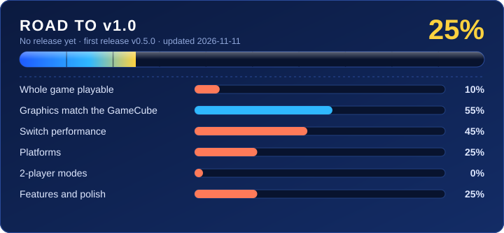

  

# Sonic Heroes native port

Play **Sonic Heroes** (GameCube, USA) natively, with no emulator, on a modded **Nintendo Switch**, and later on
**Windows**, **Android**, **Linux / Steam Deck** and **iPhone / iPad**. The game is rebuilt on your own PC from
**your own disc image**; this project contains no game files.

# ⚠️ THIS IS A TEST BUILD ⚠️

> [!CAUTION]
> ## 0.1.0-alpha.1 is a TEST BUILD for development. It is NOT for playing.
>
> - It is here so testers can **find bugs and crashes and report them**. Most of the game has **not been tried
>   yet**: expect crashes, wrong graphics, missing sound, frame-rate drops and **lost saves**.
> - Only **Seaside Hill** and the **special stage** have been played through. Everything after that is untested.
> - **PC (Windows) and Switch only.** Android, Linux / Steam Deck and iPhone / iPad come later.
> - If you just want to play Sonic Heroes, **wait for the first real release**. Day-to-day status: [STATE.md](STATE.md).

## How to report a bug or a crash

Every report helps, even a short one. **Never attach game files** (the disc image, `.iso`, `.nro`, `.exe` or
anything built from your disc).

**1. Save the report right after the problem**, before you start the game again (each start moves the last log
aside, and only one older log is kept on the Switch).

| | If the game still runs | If the game crashed or froze |
|---|---|---|
| **Switch** | Hold **− (Minus)** for the settings menu → **About** → **Save a bug report**. It writes `bug-report-<date>.zip` to `switch/sonicheroes/` on the SD card. | Don't start the game again. Put the SD card in a PC and copy `sonicheroes.log` and `sonicheroes.prev.log` from `switch/sonicheroes/`. After an Atmosphère error screen, also copy the newest file in `atmosphere/crash_reports/`. (Or start the game once and use **Save a bug report**: the crashed run is then in `sonicheroes.prev.log` in the zip.) |
| **PC** | Hold **F1** (or the controller's Back/View button) → **About** → **Save a bug report**. It writes `bug-report-<date>.zip` to the game's folder and opens that folder. | Start the game once more, then **Save a bug report**: the crashed run is in `sonicheroes.prev.log` inside the zip (the crash itself is written into the log). Or copy `sonicheroes.log` and `sonicheroes.prev.log` from the game's folder by hand. |
| **Setup** (building fails) | | Attach `setup.log` from the folder you extracted the zip to. |

**2. A picture helps for anything visual**: settings menu → **Save screenshot** (`shot_<number>.bmp`, next to
the log). GitHub doesn't take `.bmp`: open it in Paint and save it as PNG, or put it in a zip.

**3. Open a report:** [**New bug report**](https://github.com/teclilla18/sonic-heroes-recomp/issues/new?template=bug_report.yml).
The form asks for the version, Switch or PC, the console and its clocks (overclocked or not), where in the game
it happened and what you did just before. Drag the `.zip` and pictures into the **Logs** field.

The logs hold folder names from your PC and nothing else personal; look through the zip first if that matters
to you.

## Road to v1.0

<b>What v1.0 means, and what each bar still needs</b>

v1.0 = the whole game (story, Challenge and extra missions, bosses, special stages, 2-player modes) plays like
the GameCube original on every supported platform, and the Switch holds its frame rate. The first release,
v0.5.0, comes once the game is playable on the Switch and Android. The overall number is a weighted average
(game 25 %, the rest 15 % each), judged by hand after each step; `tools/make_progress.py` draws the card.

| Area | Done | Left for v1.0 |
|---|---|---|
| Whole game playable | 15 % | Done: boot, menus, Team Sonic's story movie, Seaside Hill, the special stage (Switch), Egg Fleet starts (PC). Left: every other stage, the four teams, bosses, saving, endings |
| Graphics match the GameCube | 60 % | Seaside Hill matches Dolphin (terrain shadows fixed at every resolution and in widescreen); left: the other stages' effects, indirect-texture effects, a 1-pixel line at the left edge, an HD look (bloom, shadows) |
| Switch performance | 50 % | Seaside Hill at 60 fps (handheld; ~60 at 1.5x with an overclock, user-tested), fewer dips with enemies in view; left: shaders for the rest of the game, big stages, movies, docked checks |
| Platforms | 30 % | PC and Switch boot and play; first test build (0.1.0-alpha.1): the PC zip installs cold (Windows Sandbox), the Switch zip builds; left: Android, Linux / Steam Deck, iPhone / iPad |
| 2-player modes | 0 % | Split-screen versus and battle modes not tried yet |
| Features and polish | 38 % | HOME-screen forwarder and game icon done; "Save a bug report" on PC and Switch (console-tested); launcher with Sonic Heroes art; widescreen 3D (Hor+) tested on PC, Eden and the Switch; modern controls (leader on L/R, right-stick camera turn + tilt, speed slider, A in pause) accepted on the Switch; left: menus and HUD in widescreen, launcher, installers |

## How it works

The game's PowerPC code (`main.dol` and its 18 `.rel` modules) is translated to C ahead of time on your PC
(**static recompilation**), and the GameCube hardware (graphics, disc, audio, memory card, controllers) is
reimplemented natively: deko3d on the Switch, OpenGL / Vulkan elsewhere. This project is a fork of the
[Sonic Riders native port](https://github.com/teclilla18/sonic-riders-recomp), which follows
[SwitchWakerHD](https://github.com/centollOS/SwitchWakerHD) and
[ZeldaWWHDRecomp](https://github.com/ZeldaWWHDRecomp/ZeldaWWHDRecomp), whose PowerPC→C translator it forks.

## Legal

- A fan project, **not affiliated with, endorsed or sponsored by SEGA or Nintendo**. "Sonic Heroes" and "Nintendo
  Switch" are trademarks of their owners, used only to describe what this works with.
- **This repository contains no game code, assets, data or console keys.** You need your own disc image of Sonic
  Heroes (USA), made from a disc you own. Everything derived from the game is generated locally on your PC.
- **Never share** your built `.nro`, `.exe` or `.nsp`, or your disc image.

Licensed under the [Mozilla Public License 2.0](LICENSE), like the translator it forks
(`third_party/LICENSE-MPL-2.0`).

## Credits

- The [Sonic Riders native port](https://github.com/teclilla18/sonic-riders-recomp): everything this starts from.
- [SwitchWakerHD](https://github.com/centollOS/SwitchWakerHD) and
  [ZeldaWWHDRecomp](https://github.com/ZeldaWWHDRecomp/ZeldaWWHDRecomp): the approach and the PowerPC→C translator (MPL-2.0).
- [Dolphin](https://dolphin-emu.org/): hardware documentation and behaviour reference (no Dolphin code is included).
- [decomp-toolkit](https://github.com/encounter/decomp-toolkit), [devkitPro](https://devkitpro.org/),
  [libnx](https://github.com/switchbrew/libnx), [deko3d](https://github.com/devkitPro/deko3d),
  [SDL2](https://www.libsdl.org/), [llvm-mingw](https://github.com/mstorsjo/llvm-mingw),
  [Dear ImGui](https://github.com/ocornut/imgui) (MIT),
  [AMD FidelityFX Super Resolution 1](https://github.com/GPUOpen-Effects/FidelityFX-FSR) (MIT).
- Game icon (`setup/icon.png`, used for every console's build): fan-made
  [Sonic Heroes icon](https://www.deviantart.com/somegameicons/art/Sonic-Heroes-icon-422952372) by
  [somegameicons](https://www.deviantart.com/somegameicons) on DeviantArt, used with credit, shown on a plain dark
  blue background. somegameicons, if you'd like it changed or removed, open an issue and we'll do it right away.
- Launcher banner (`launcher/banner.jpg`): fan art of Sonic, Tails and Knuckles by **Reckoman12**
  ([@Reckoman12](https://x.com/Reckoman12)), used with credit.
- Launcher icon (`launcher/icon_*.png`): fan art of Team Sonic by digital artist **Nibroc.Rock**, used with credit.
- Reckoman12, Nibroc.Rock: if you'd like your art changed or removed, open an issue and we'll do it right away.

Sonic Heroes is © SEGA. This project is not affiliated with SEGA.
