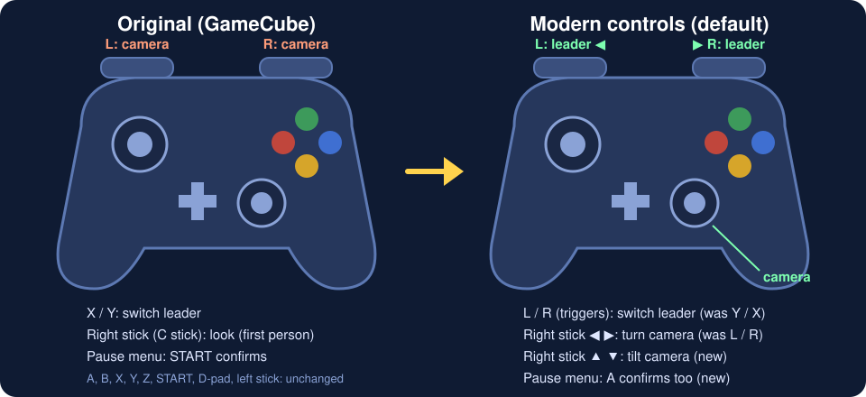
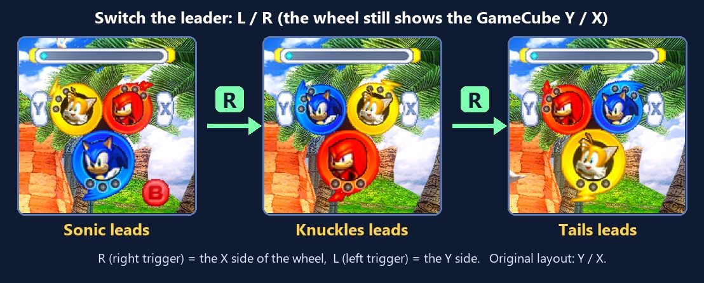
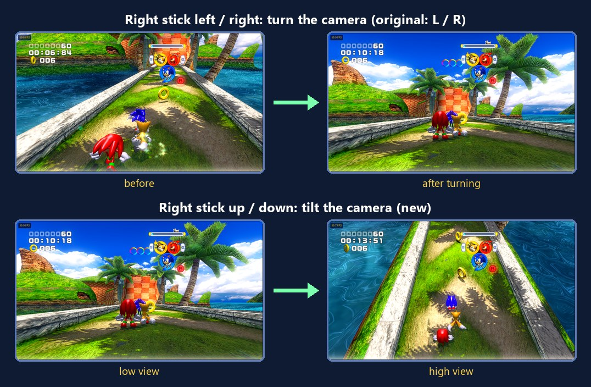

# ⚠️ THIS IS A TEST BUILD ⚠️

> [!CAUTION]
> ## 0.1.0-alpha.1 is a TEST BUILD for development. It is NOT for playing.
>
> - It is here so testers can **find bugs and crashes and report them**. Most of the game has **not been tried
>   yet**: expect crashes, wrong graphics, missing sound, frame-rate drops and **lost saves**.
> - Only **Seaside Hill** and the **special stage** have been played through. Everything after that is untested.
> - **PC (Windows) and Switch only.** Android, Linux / Steam Deck and iPhone / iPad come later.
> - If you just want to play Sonic Heroes, **wait for the first real release**.

This download contains **no game files**. The setup builds the game on your PC from **your own** Sonic Heroes
(USA) disc image (G9SE8P, revision 0). Never share your disc image or anything the setup builds from it.

## Which file?

| You have | Download | Then |
|---|---|---|
| A Switch with custom firmware (Atmosphère) | `SonicHeroes-Switch-Setup-0.1.0-alpha.1.zip` | Extract it, run `Install Sonic Heroes (Switch).exe`, pick your disc image and SD card. Start the game from the Homebrew Menu (hold R while starting any game). |
| A Windows 10 / 11 PC | `SonicHeroes-PC-Setup-0.1.0-alpha.1.zip` | Extract it, run `SonicHeroesLauncher.exe`, pick your disc image, press INSTALL AND PLAY. |

The first build takes 10-30 minutes. `README-FIRST.txt` in each zip has the full steps.

## Controls: what is different from the GameCube

The port starts with **Modern controls** on: the shoulder triggers switch the leader and the right stick moves the
camera, like most 3D games today. Everything else is the GameCube layout. You can go back to the original layout
any time: settings menu → **Gameplay** → **Modern controls** off.

| | Original (GameCube) | Modern controls (default) |
|---|---|---|
| Switch the leader | **Y** / **X** | **L** / **R** triggers (Switch **ZL** / **ZR**, Xbox **LT** / **RT**, keys **U** / **O**). Y / X still work too. |
| Turn the camera | **L** / **R** | **Right stick** left / right |
| Tilt the camera up / down | not possible | **Right stick** up / down (new) |
| Right stick (C stick) | first-person look | camera (see above) |
| Pause menu | **START** confirms | **A** confirms too |
| Everything else (A, B, X, Y, Z, START, D-pad, left stick) | | unchanged |

**The leader wheel** (top right during a stage) still shows the GameCube's **Y** and **X** next to it. With
modern controls, **L** does what Y does and **R** does what X does:

**The camera** turns with the right stick (the GameCube used L / R), and tilts with it, which the original could not
do. How fast it turns: settings menu → **Gameplay** → **Camera speed** (100 % = the game's own speed).

**Special stages** steer with the left stick alone. The full range was hard to control, so the port scales it:
**Gameplay** → **Special stage steering** (default 60 %, 100 % = the original).

### Which button is which

| GameCube | Switch | PC: controller (Xbox layout) | PC: keyboard |
|---|---|---|---|
| Control stick | Left stick | Left stick | W A S D |
| C stick | Right stick | Right stick | Arrow keys |
| A / B / X / Y | A / B / X / Y | A / B / X / Y | J / K / L / I |
| L / R | ZL / ZR | LT / RT | U / O |
| Z | R | RB | P |
| START | + | Start (Menu) | Enter |
| D-pad | D-pad | D-pad | T F G H |
| Settings menu | hold **−** (Minus) | hold **Back / View** | hold **F1** |

On PC the buttons and keys can be changed on the launcher's **Controls** page.

## How to report a bug or a crash

**1. Save the report right after the problem**, before you start the game again.

| | If the game still runs | If the game crashed or froze |
|---|---|---|
| **Switch** | Hold **− (Minus)** → **About** → **Save a bug report**. It writes `bug-report-<date>.zip` to `switch/sonicheroes/` on the SD card. | Don't start the game again. Copy `sonicheroes.log` and `sonicheroes.prev.log` from `switch/sonicheroes/` on the SD card. After an Atmosphère error screen, also copy the newest file in `atmosphere/crash_reports/`. |
| **PC** | Hold **F1** (or the controller's Back/View button) → **About** → **Save a bug report**. It writes `bug-report-<date>.zip` to the game's folder and opens it. | Start the game once more, then **Save a bug report**: the crashed run is in `sonicheroes.prev.log` inside the zip. |
| **Setup** (building fails) | | Attach `setup.log` from the folder you extracted the zip to. |

**2. A picture helps for anything visual:** settings menu → **Save screenshot** (`shot_<number>.bmp` next to the
log; save it as PNG for GitHub).

**3. Open a report:** [**New bug report**](https://github.com/teclilla18/sonic-heroes-recomp/issues/new?template=bug_report.yml)
and drag the zip / logs and pictures into it. Say Switch or PC, docked or handheld, your clocks (overclocked or
not), where in the game it happened and what you did just before. **Never attach game files.**

## What to test

- Start the game, go through the menus, play **Seaside Hill** and a **special stage**.
- Then go further: other stages, other teams, bosses, Challenge mode. Every crash or freeze report there helps.
- Switch: tell us your frame rate (settings menu → FPS counter), docked or handheld, and your clocks.

## Known issues

- Widescreen ("Fit window"): menus are stretched, the pause menu is off-centre and the team icon / Team Blast
  gauge sit near the middle instead of the screen edges. Use 4:3 if that bothers you.
- The special stage looks brighter than on the GameCube.
- Stages after Seaside Hill have not been played through; many may crash or look wrong.
- Switch at stock clocks: frame rate untested; the test console runs overclocked (CPU 1785 MHz).
